# GitHub Repo Badges & Achievements Guide

A complete, accurate reference and tutorial guide for unlocking every GitHub profile achievement, badge tier, and account highlight.

All asset files are hosted locally within this repository for fast, reliable rendering. Detailed walkthroughs for each achievement are provided in the [docs/](docs/) directory.

---

## Table of Contents

- [Active Achievements](#active-achievements)
- [Emoji Skin Tone Variations](#emoji-skin-tone-variations)
- [Profile Highlights](#profile-highlights)
- [Retired & Legacy Badges](#retired--legacy-badges)
- [Experimental & Unreleased Badges](#experimental--unreleased-badges)
- [Profile Visibility & Settings](#profile-visibility--settings)
- [License](#license)

---

## Active Achievements

These achievements can be unlocked through normal GitHub activity. Multi-tier achievements upgrade automatically as contribution thresholds are met.

| Badge | Achievement | Criteria | Available Tiers & Requirements | Tutorial |
| :---: | :--- | :--- | :--- | :---: |
|  | **Pull Shark** | Opened pull requests that were merged into the default branch. | <table><thead><tr><th>Default</th><th>Bronze</th><th>Silver</th><th>Gold</th></tr></thead><tbody><tr><td></td><td></td><td></td><td></td></tr><tr><td align="center">2</td><td align="center">16</td><td align="center">128</td><td align="center">1,024</td></tr></tbody></table> | [Guide](docs/achievements/pull-shark.md) |
| 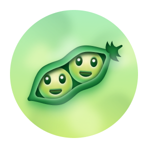 | **Pair Extraordinaire** | Co-authored commits on pull requests merged into the default branch. | <table><thead><tr><th>Default</th><th>Bronze</th><th>Silver</th><th>Gold</th></tr></thead><tbody><tr><td></td><td>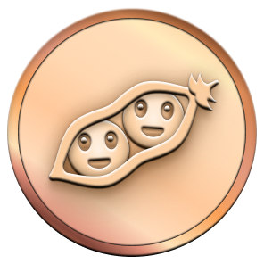</td><td>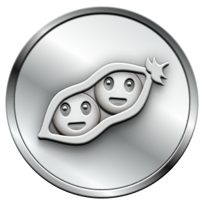</td><td></td></tr><tr><td align="center">1</td><td align="center">10</td><td align="center">24</td><td align="center">48</td></tr></tbody></table> | [Guide](docs/achievements/pair-extraordinaire.md) |
|  | **Galaxy Brain** | Had answers accepted in GitHub Discussions (Q&A category). | <table><thead><tr><th>Default</th><th>Bronze</th><th>Silver</th><th>Gold</th></tr></thead><tbody><tr><td></td><td>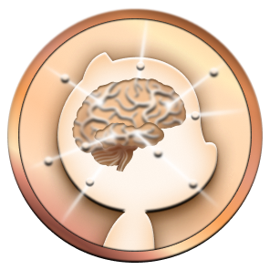</td><td></td><td></td></tr><tr><td align="center">2</td><td align="center">8</td><td align="center">16</td><td align="center">32</td></tr></tbody></table> | [Guide](docs/achievements/galaxy-brain.md) |
|  | **Starstruck** | Created repository or repositories that accumulated star milestones. | <table><thead><tr><th>Default</th><th>Bronze</th><th>Silver</th><th>Gold</th></tr></thead><tbody><tr><td></td><td>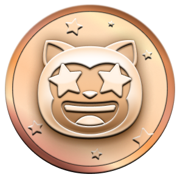</td><td>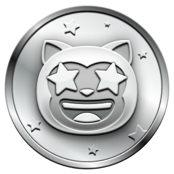</td><td>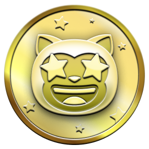</td></tr><tr><td align="center">16</td><td align="center">128</td><td align="center">512</td><td align="center">4,096</td></tr></tbody></table> | [Guide](docs/achievements/starstruck.md) |
|  | **Quickdraw** | Closed an issue or pull request within 5 minutes of opening it. | <table><thead><tr><th>Default</th></tr></thead><tbody><tr><td></td></tr><tr><td align="center">1</td></tr></tbody></table> | [Guide](docs/achievements/quickdraw.md) |
|  | **YOLO** | Merged a pull request without waiting for or receiving a code review. | <table><thead><tr><th>Default</th></tr></thead><tbody><tr><td></td></tr><tr><td align="center">1</td></tr></tbody></table> | [Guide](docs/achievements/yolo.md) |
|  | **Public Sponsor** | Actively sponsored an open-source contributor via [GitHub Sponsors](https://github.com/sponsors). | <table><thead><tr><th>Default</th></tr></thead><tbody><tr><td></td></tr><tr><td align="center">1 active</td></tr></tbody></table> | [Guide](docs/achievements/public-sponsor.md) |

---

## Emoji Skin Tone Variations

The visual appearance of **Starstruck** and **Quickdraw** reflects your selected Emoji Skin Tone preference. You can modify this preference at [Appearance Settings](https://github.com/settings/appearance).

| Achievement | Default (👋) | Light (👋🏻) | Medium-Light (👋🏼) | Medium (👋🏽) | Medium-Dark (👋🏾) | Dark (👋🏿) |
| :---: | :---: | :---: | :---: | :---: | :---: | :---: |
| **Starstruck** |  | 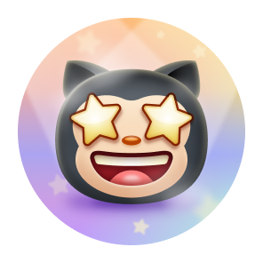 | 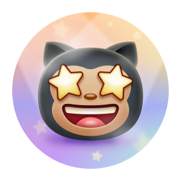 | 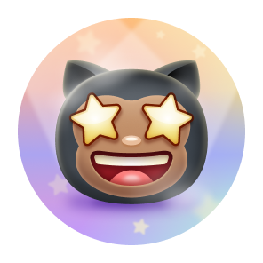 | 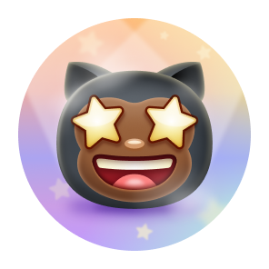 | 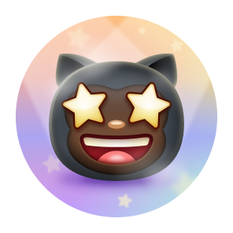 |
| **Quickdraw** |  | 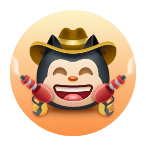 | 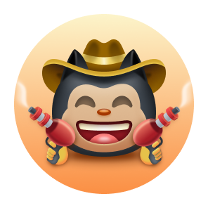 | 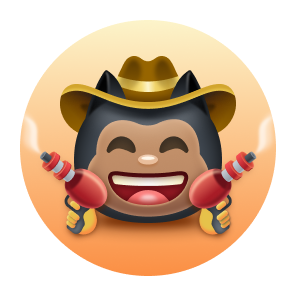 | 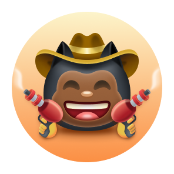 | 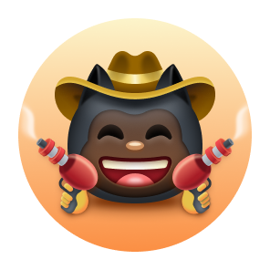 |

---

## Profile Highlights

Highlights are special status badges displayed in the profile sidebar below user bios. They correspond to account status and official programs rather than contribution volume.

| Badge Preview | Highlight Name | Description & Qualification |
| :---: | :--- | :--- |
|  | **Pro** | Subscribed to [GitHub Pro](https://github.com/pricing) or active in the [GitHub Student Developer Pack](https://education.github.com/pack). |
|  | **Developer Program Member** | Registered member of the [GitHub Developer Program](https://docs.github.com/en/developers/overview/github-developer-program). |
|  | **GitHub Campus Expert** | Completed leadership training in the [GitHub Campus Program](https://education.github.com/experts). |
|  | **Security Advisory Credit** | Credited on a published CVE advisory in the [GitHub Advisory Database](https://github.com/advisories). |
|  | **Security Bug Bounty Hunter** | Reported a confirmed security vulnerability through the [GitHub Bug Bounty](https://bounty.github.com/). |

*For complete application processes and prerequisites, see [docs/highlights/profile-highlights.md](docs/highlights/profile-highlights.md).*

---

## Retired & Legacy Badges

These historical badges are no longer earnable. They remain permanently preserved on profiles of accounts that contributed to specific platform milestones.

| Badge | Achievement Name | Milestone Description |
| :---: | :--- | :--- |
|  | **Mars 2020 Contributor** | Contributed code to a repository utilized in the NASA Jet Propulsion Laboratory [Mars 2020 Helicopter Mission](https://github.com/readme/featured/nasa-ingenuity-helicopter) (*Ingenuity*). |
| 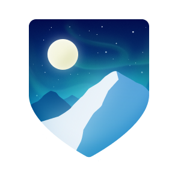 | **Arctic Code Vault Contributor** | Contributed code to a public repository captured in the 02/02/2020 archive snapshot for the [GitHub Archive Program](https://archiveprogram.github.com/). |

---

## Experimental & Unreleased Badges

These badges were discovered in platform assets or run in limited beta tests:

| Badge | Badge Name | Known Details |
| :---: | :--- | :--- |
| 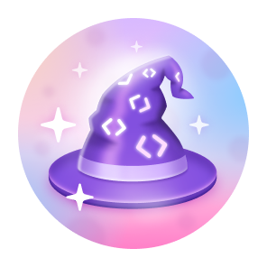 | **Open Sourcerer** | Experimental badge intended for developers with pull requests merged across multiple independent public open-source repositories. |
| 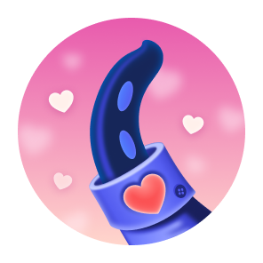 | **Heart on Your Sleeve** | Discovered in platform assets; tested in connection with ❤️ emoji reactions on issues and discussions. |

---

## Profile Visibility & Settings

- **Show or hide achievements:** Visit [Settings > Public Profile](https://github.com/settings/profile) and toggle **Show Achievements on my profile**.
- **Private repository contributions:** Enable **Include private contributions on my profile** to ensure qualifying private PRs and commits increment achievement counters.
- **Troubleshooting and delay:** Badges take between 5 minutes and 24 hours to appear due to queue processing. See [docs/faq.md](docs/faq.md) for full troubleshooting advice.

---

## License

This documentation and project layout is licensed under the [MIT License](LICENSE). GitHub badge artwork and brand assets remain the copyright of GitHub, Inc.
