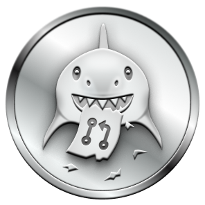
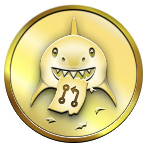

# Pull Shark Achievement Guide

The **Pull Shark** achievement is awarded to GitHub users who open pull requests that are subsequently merged into a repository's default branch.

---

## Achievement Tiers

| Tier | Required Merged Pull Requests | Badge Preview |
| :--- | :---: | :---: |
| **Default** | 2 |  |
| **Bronze** | 16 |  |
| **Silver** | 128 |  |
| **Gold** | 1,024 |  |

---

## How It Works

To make progress toward this achievement:
1. You must be the author of the pull request.
2. The pull request must be opened against a repository (either your own repository or an open-source project).
3. The pull request must be merged into the target repository's **default branch** (commonly `main` or `master`). Closed without merging does not count.
4. Both public and private repository PR merges count toward the badge, provided your GitHub account settings allow private contributions to be counted.

---

## Step-by-Step Walkthrough (Your Own Repository)

You can achieve the Default tier using any personal repository:

### 1. Create a feature branch
```bash
git checkout -b feature/update-documentation
```

### 2. Make and commit your changes
```bash
echo "# New Update" >> notes.md
git add notes.md
git commit -m "docs: add release notes"
```

### 3. Push the feature branch to GitHub
```bash
git push -u origin feature/update-documentation
```

### 4. Open and merge the Pull Request
Using GitHub CLI:
```bash
gh pr create --base main --head feature/update-documentation --title "docs: update documentation" --body "Adds notes.md"
gh pr merge feature/update-documentation --merge --delete-branch
```
Or via the GitHub web interface:
1. Navigate to the repository on GitHub.
2. Click **Compare & pull request**.
3. Click **Create pull request**.
4. Click **Merge pull request** and confirm.

---

## Important Rules & Edge Cases

- **Merged vs. Closed:** The PR must be merged. If a PR is simply closed without merging, it will not count.
- **Default Branch:** PRs merged into development branches (e.g., `dev`, `staging`) do not trigger the counter unless that branch is designated as the repository's default branch in Settings > General > Default branch.
- **Delay:** Badges typically appear within 5 to 60 minutes after the qualifying PR is merged.
