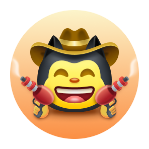

# Quickdraw Achievement Guide

The **Quickdraw** achievement is awarded to users who close an issue or pull request within **5 minutes** of its creation.

---

## Achievement Tier

| Tier | Required Trigger | Badge Preview |
| :--- | :---: | :---: |
| **Default** | 1 fast close (≤ 5 minutes) |  |

*Note: Quickdraw is a single-tier achievement, but its visual appearance adapts to your selected [Emoji Skin Tone preference](https://github.com/settings/appearance).*

---

## How It Works

GitHub checks the timestamp delta between creation and closure:
$$\Delta t = \text{Closed At} - \text{Created At} \le 5\text{ minutes}$$

Either closing an **Issue** or closing a **Pull Request** satisfies the condition.

---

## Fastest Unlocking Walkthrough (Using GitHub CLI)

You can complete this on any public or private repository you own in less than 30 seconds using the `gh` CLI.

### Option A: Via Issue (Simplest)

```bash
# 1. Create the issue
ISSUE_URL=$(gh issue create --title "Investigate typo" --body "Testing quick turnaround")

# 2. Extract issue number and immediately close it
gh issue close "$ISSUE_URL" --reason "completed"
```

### Option B: Via Web Browser

1. Navigate to your repository's **Issues** tab.
2. Click **New issue**.
3. Type any title (e.g., `Test issue`) and click **Submit new issue**.
4. Scroll down immediately and click **Close issue** (or **Close as completed**).

---

## Skin Tone Support

The Quickdraw badge features 6 emoji skin tone variants:
- Default (Yellow 👋)
- Light (👋🏻)
- Medium-Light (👋🏼)
- Medium (👋🏽)
- Medium-Dark (👋🏾)
- Dark (👋🏿)

To change your badge's skin tone:
1. Visit [Appearance Settings](https://github.com/settings/appearance).
2. Under **Emoji skin tone preference**, select your preferred tone.
3. Reload your profile page.
